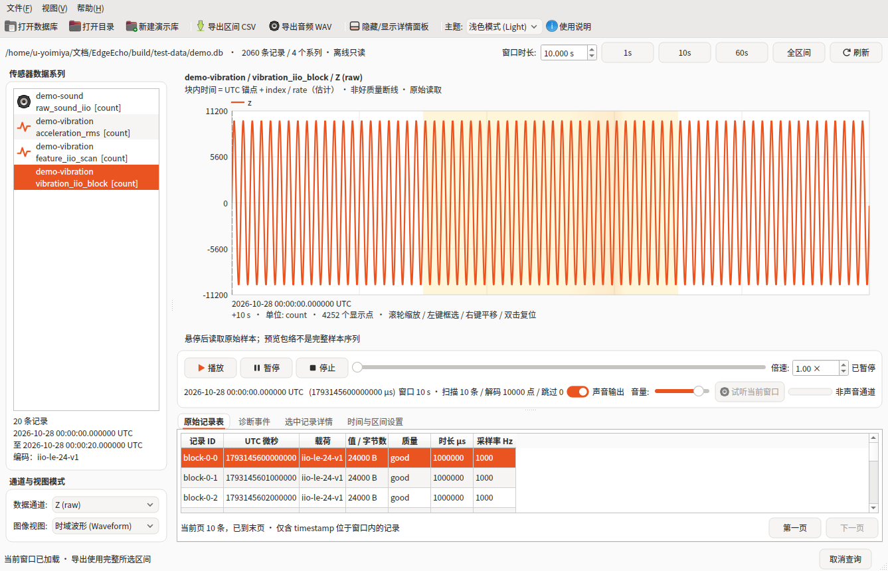
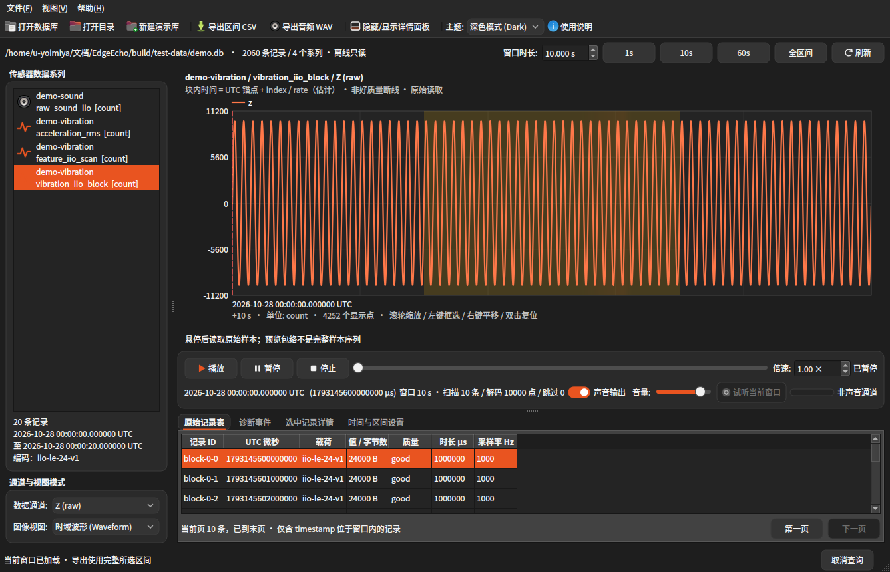
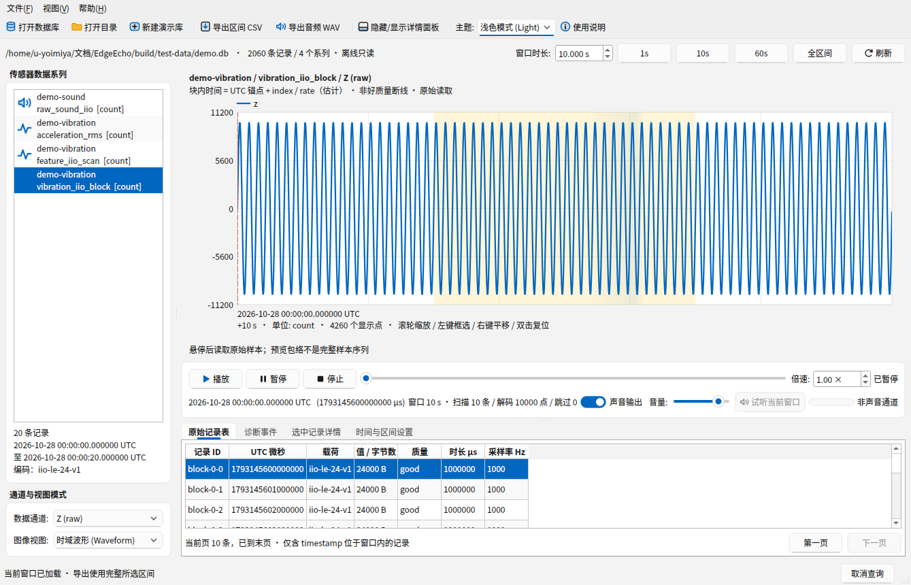
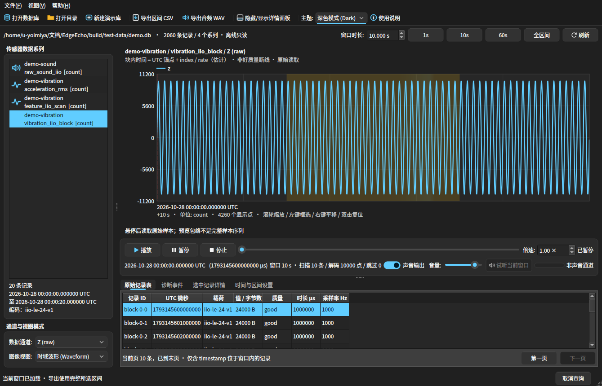

# EdgeEcho

用于 EdgeSense Replay 数据库的 C++17 离线回放软件，包含 Qt 6 桌面界面与独立命令行。Windows、Linux 共用核心代码，使用标准库和 Qt，无 epoll 或 Linux 专用采集接口。

先阅读的[开发报告](docs/DEVELOPMENT_REPORT.md)已在实现前形成；实际验证结果见 [VALIDATION.md](docs/VALIDATION.md)。

当前版本为 **0.5.0**。历史复盘见 [首版开发评估](docs/DEVELOPMENT_REPORT_2026-10-29.md)；往期成果见 [第二阶段报告](docs/PHASE2_DEVELOPMENT_REPORT_2026-10-29.md)、[第三阶段报告](docs/PHASE3_DEVELOPMENT_REPORT_2026-10-29.md) 和 [第四阶段报告](docs/PHASE4_DEVELOPMENT_REPORT_2026-11-05.md)；Windows 平台原生编译交付说明见 [Windows AI 接力指南](docs/WINDOWS_AI_HANDOFF.md)。

## 界面预览（Linux Ubuntu Yaru / GTK4 & Windows 11 Fluent / WinUI 3 · 浅色 / 深色模式）

| Linux (Ubuntu GNOME / GTK4 / Yaru) 浅色 | Linux (Ubuntu GNOME / GTK4 / Yaru) 深色 |
| :---: | :---: |
|  |  |
| **Windows 11 (Fluent / WinUI 3 / Mica) 浅色** | **Windows 11 (Fluent / WinUI 3 / Mica) 深色** |
|  |  |

## 现在运行

本机已经构建完成，在此目录运行：

```bash
./tools/run.sh
```

也可传入数据库文件或含 `replay.db` 的目录：

```bash
./tools/run.sh "/path/to/history/replay.db"
```

首次使用可点击「新建演示库」，将演示文件保存到本目录 `demo/` 等位置；演示数据明确标记为 simulated。已生成的测试演示库是 `build/test-data/demo.db`，可直接打开。

**输入须为已关闭写入、完成 checkpoint 的离线数据库或正式备份中的独立数据库文件。** 非空 `-wal` / `-journal` 文件会被拒绝。请正常关闭存储连接，或通过存储项目的备份功能生成快照，再打开其中的数据库；不要手动删除 WAL 或直接从运行中的采集目录只复制主文件。EdgeEcho 不恢复、不迁移、不改写原库，也不创建源库的 WAL/SHM。`immutable` 只用于上述明确离线输入，不支持边写边播。

## 桌面操作

1. 打开数据库，左侧按「传感器 / 指标 / 单位」选择系列，再选择数据通道、量纲模式（`ADC 原始值 (count)` / `物理工程量纲 (Physical)`）与图像视图模式（`时域波形 Waveform` / `FFT 频谱图 Spectrum` / `STFT 时频瀑布图 Spectrogram` / `联动双视图：时域 + 频谱 Dual`）。界面全面使用 Linux / Windows 系统原生控件与系统主题配色（`QMainWindow`、`QMenuBar`、`QToolBar`、`QGroupBox`、`QTabWidget`、`QPalette`），并配有平滑过渡与动态反馈动画。
2. 默认查看 10 秒窗口。播放、暂停、停止、倍速，以及时间轴鼠标/键盘、图上单击和精确时间跳转共同控制位置。相邻窗口低优先级预取，最多缓存3个窗口及估计32 MiB结果。
3. 选中声音（`iio-le-16-v1`）或波形系列时，软件支持实时系统声卡音频输出（Linux PulseAudio / PipeWire / ALSA 动态加载，Windows WinMM `waveOut`）、WSOLA 倍速保调时间伸缩（随倍速同步变速不变调）、零相位二阶 Butterworth 数字滤波听诊模式（全频段原声 / 高通除噪 / 共振带通 / 低通包络）、音量滑块、静音开关、「试听当前窗口」及实时动态电平指示，并可将当前窗口或区间导出为标准 RIFF WAVE（16-bit PCM `.wav`）音频文件。
4. 底部面板分类收纳「原始记录表」、「诊断事件」、「选中记录详情」与「时间与区间设置」（含日历选择与 0..999 微秒余数、精确 UTC 微秒输入），可随时通过工具栏「隐藏/显示详情面板」平滑收起或展开。
5. 原始记录表分页显示当前窗口内 timestamp 属于 `[start,end)` 的记录。详情显示原始质量、rate、source、batch、metadata 和前 256 字节预览。跨入窗口起点的波形参与画图，不会因此改变原始记录表/CSV的选择语义。
6. 事件表和背景阴影使用有效最新诊断版本，已撤销事件不显示；双击事件跳转。
7. 滚轮以指针位置缩放，左键拖动框选，右键/中键平移，双击或Esc复位。选中振动数据的「XYZ 同屏」可同时比较三轴；切换「FFT 频谱图」可查看去直流 + Hann 窗的频域幅值谱、主频峰值信标与悬停频点读数。
8. 悬停先显示包络预览，再在后台查询最近的有效原始样本，给出真实数值、样本时间和与指针的时间差；没有插值。波形样本的时间仍是按采样率重建的估计。
9. 「导出区间 CSV」导出整个选中回放区间的原始记录，BLOB保留为 `block_hex`，metadata保留原串；「导出音频 WAV」导出 16-bit 单声道 PCM `.wav` 文件。两者均通过私有临时文件写完后才原子发布正式文件，不覆盖已有文件。

曲线按时间桶保留 min/max，尖峰不会因简单抽点丢失。缺失或非零质量会断开曲线；质量 good 不表示诊断正常。原始 count 不自动换算物理单位。波形块内时间使用 `timestamp + index / sample_rate_hz` 重建，界面标明估计；缺 rate 不虚构采样率。多种编码混合的系列可查看/导出，只有通道语义一致的记录能一并解码。

## 支持的数据

只接受 application_id=1163088464、schema v3、payload version=1 的 EdgeSense Replay 库。v1/v2 请用存储项目迁移**副本**，本软件不会自动升级原文件。

| 数据 | 通道 |
| --- | --- |
| scalar / missing | value |
| iio-le-24-v1 | x、y、z，24字节 IIO scan 中的 s16 原值 |
| iio-le-16-v1 | sound，16字节 IIO scan 中的 s32 PCM 原值 |
| iio-le-72-v1 | 29个特征通道，使用记录时刻，可无 rate |
| s16le / s32le / f32le / f64le | value，明确小端单通道波形 |
| 未知编码 | 原始记录检查和字节导出，禁止猜解码 |

标量上的非空 encoding 不影响 scalar 读取。单位是系列身份的一部分；不同单位不会混合绘制。

## 从源码构建

依赖：CMake ≥3.20、C++17 编译器；桌面版另需 Qt ≥6.2 Widgets、Concurrent。SQLite 3.54.1 已包含在源码中，不访问外部存储项目即可构建。

Linux，Qt 开发包可由发行版或 Qt 官方安装器提供：

```bash
cmake -S . -B build -DCMAKE_BUILD_TYPE=Release
cmake --build build --parallel 2
ctest --test-dir build --output-on-failure
./build/edgeecho
```

本机的 Qt 开发包解压在项目 `.deps/qt` 中，`./tools/build.sh -DEDGEECHO_BUILD_GUI=ON` 会自动配置这些本地路径；没有写入系统安装目录。`.deps` 不作为项目源码分发。

Windows，安装 Visual Studio 2022 C++ 和相应 MSVC 版 Qt，使用开发者 PowerShell：

```powershell
cmake -S . -B build -DCMAKE_PREFIX_PATH="C:/Qt/6.8.3/msvc2022_64"
cmake --build build --config Release --parallel 2
ctest --test-dir build -C Release --output-on-failure
windeployqt build/Release/edgeecho.exe
.\build\Release\edgeecho.exe
```

`tools/build.ps1` 也可使用。分发 Qt 程序需携带匹配版本的 Qt DLL 与平台插件，保留相应许可；详见 [THIRD_PARTY_NOTICES.md](THIRD_PARTY_NOTICES.md)。本机已产出 `build-windows/edgeecho_cli.exe` 及核心测试PE文件，Windows桌面版需在Windows Qt环境原生构建；本机没有Windows实际运行验收。

仅构建命令行与核心：

```bash
cmake -S . -B build-core -DEDGEECHO_BUILD_GUI=OFF -DCMAKE_BUILD_TYPE=Release
cmake --build build-core --parallel 2
ctest --test-dir build-core --output-on-failure
```

## 命令行

```bash
./build/edgeecho_cli demo demo.db --records 20000
./build/edgeecho_cli inspect demo.db
./build/edgeecho_cli records demo.db --sensor demo-vibration --type acceleration_rms --unit count
./build/edgeecho_cli export demo.db output.csv --sensor demo-vibration --type acceleration_rms --unit count
./build/edgeecho_cli audio demo.db output.wav --sensor demo-sound --type sound_iio_block --unit count --channel sound --low-cut 50 --high-cut 250
./build/edgeecho_cli spectrum demo.db --sensor demo-sound --type sound_iio_block --unit count --channel sound --bins 512
./build/edgeecho_cli spectrogram demo.db --sensor demo-sound --type sound_iio_block --unit count --channel sound --time-bins 64 --freq-bins 64
./build/edgeecho_cli benchmark demo.db --sensor demo-vibration --type vibration_iio_block --unit count --channel x
```

`--start`、`--end` 可指定 UTC 微秒。两者均提供且系列明确时，records/export/plot/audio/spectrum/benchmark/probe无需先进行全库目录统计。`probe DB --sensor ID --type TYPE --unit UNIT --start UTC_US --end UTC_US --at UTC_US --channel x` 返回最近有效原始样本及时间，明确不插值。导出可用 `--export-timeout-ms` 调整总任务时限。`records` 输出逐行 JSON，含原始十六进制载荷；`plot` 输出有界曲线点，`audio` 导出标准 16-bit PCM `.wav` 文件，`spectrum` 输出 FFT 频谱 JSON，`benchmark` 输出实际查询耗时与计数。`--help` 显示参数。错误返回非零退出码。

## 资源上限与开发接口

默认单记录8 MiB、单页16 MiB/512条、单次曲线最多扫描25万记录/解码1000万个通道值、交互操作15秒；事件也限制总条数与总字节。XYZ共用一次数据库扫描，解码值和输出字节预算合并执行。导出默认总任务30分钟，各页数据库查询仍受交互预算限制。超限须缩短区间，或者由嵌入调用者通过 `Limits` 明确调整，不会静默截断成功结果。可用 `Cancel` 中止后台读取。显示点数通常不超过视口桶数的两倍，质量中断会增加少量边界点，过多中断也会明确报错。

接口见 `include/edgeecho/core.hpp`。`Database` 属于单个工作线程；`identity()`取得离线源身份，后续工作线程通过构造参数expected_source绑定同一个文件，克隆数据库即使ID/大小/mtime相同，路径被替换也会拒绝。Qt主线程只持有有界结果。`PlaybackClock` 是独立虚拟时钟，使用调用者提供的单调经过时间，GUI 不把曲线降采样当作逐条原始数据投递；需要完整原始数据时使用键集分页或 CSV。`AudioPlayer` 提供跨平台实时音频输出（Linux PulseAudio / ALSA 动态加载与 Windows `winmm`），`encode_wav` 与 `compute_spectrum` 提供标准 WAV 编码与 Hann 窗 FFT 频谱计算。

本次实现不包含实时采集、并发活跃库读取、数据库写入和在线诊断推理算法。Windows 原生并不完整提供 POSIX，跨平台能力通过标准 C++、SQLite、平台原生音频接口和 Qt 实现。

## 验证工具

- CTest：数据库/只读/事件/预算、编码/时钟/音频/FFT、CLI、Qt 多窗口多通道 offscreen 冒烟。
- `tests/gui/smoke.py`：图形界面、Unicode路径、错误库和源库不变检查。
- `tests/performance/`：历史合成性能与100次重复浏览基准；最新结果见 `docs/evidence/current-performance.json`，历史 `performance.json` 不代表当前程序。
- `tests/compatibility/`：使用只读参考项目的原始写入库生成并验证兼容文件，构建输出放在 EdgeEcho 内。
- `.github/workflows/build.yml`：Windows/Linux Qt 编译与测试、Linux sanitizer。该配置尚未在远端 CI 执行，不能当作已通过的 Windows 运行证据。

## 当前版本验证与独立运行包

```bash
python3 tools/validate_current.py --profiles release asan windows-cross \
  --report docs/evidence/current-validation.json --parallel 4
python3 tools/package_linux.py --build-dir build --output dist-linux
python3 tools/validate_package.py \
  --package dist-linux/EdgeEcho-0.5.0-linux-x86_64 \
  --validation-report docs/evidence/current-validation.json
```

验证器每次生成新的CTest/JUnit结果，拒绝空测试、跳过、旧结果和源码变化，并检查GUI/CLI构建标识。Windows交叉构建只作为PE/编译证据，不能替代原生运行。

Linux包包含Qt运行库、平台插件、相对路径启动器和许可文件。解压后运行包根目录的 `./edgeecho`；它不依赖项目的 `.deps`，但仍要求兼容的系统ABI、字体和图形环境，不能据此保证旧版Linux兼容。Windows原生构建后可使用 `tools/package_windows.ps1`，部署与实际运行由Windows工作流验收。
